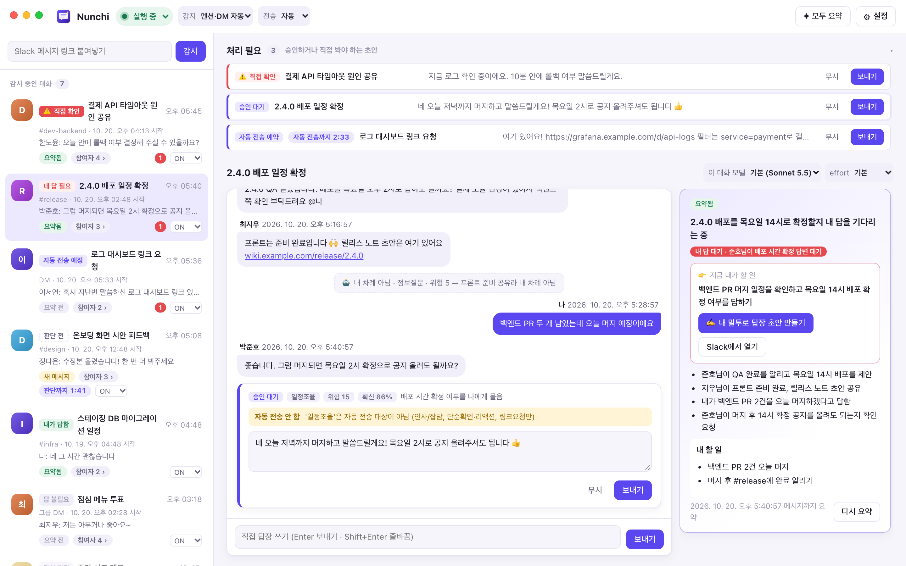
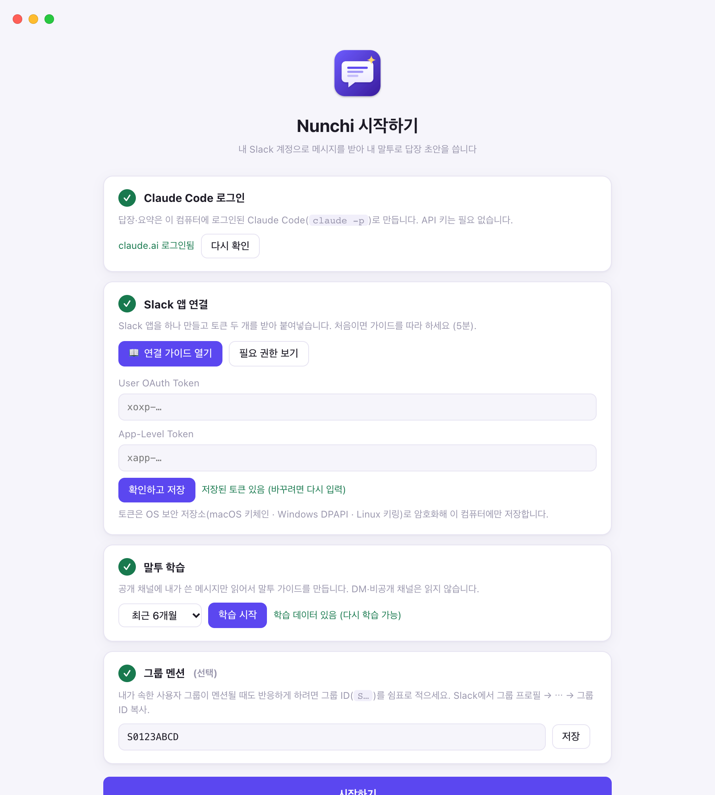
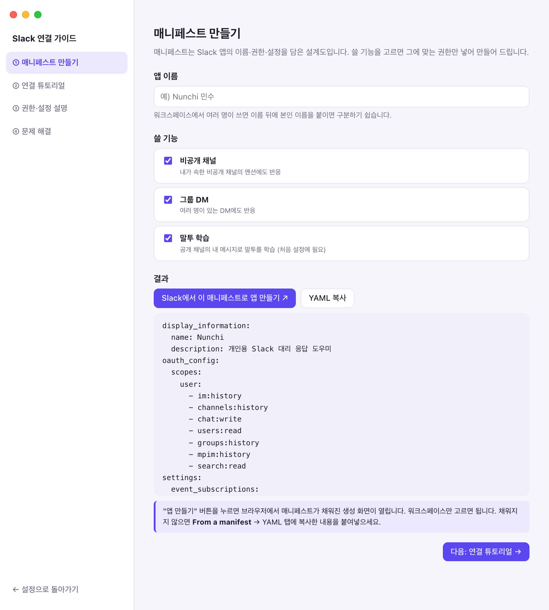
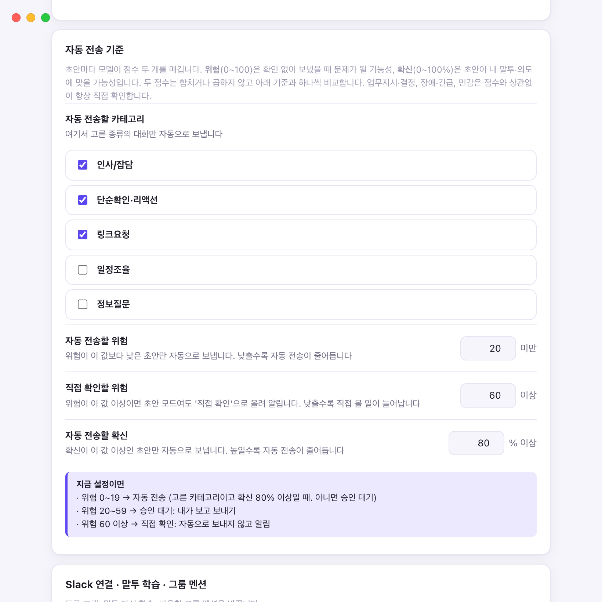

<p align="center"></p>

<h1 align="center">Nunchi</h1>

내 Slack 계정으로 들어온 메시지를 받아 **내 말투로 답장 초안**을 쓰고, 위험도에 따라 자동 전송 / 승인 대기 / 직접 확인으로 나누는 데스크톱 앱입니다. macOS · Windows · Linux에서 돌아갑니다. 대화 요약과 SSH 원격 제어도 됩니다.

- LLM은 이 컴퓨터에 로그인된 **Claude Code**(`claude -p`)를 씁니다. API 키는 필요 없습니다.
- Slack은 각자 만든 Slack 앱의 **User Token**으로 동작합니다. 보내는 메시지는 내 이름으로 나갑니다.

<picture>
  <source media="(prefers-color-scheme: dark)" srcset="docs/screenshots/main-dark.png" />
  
</picture>

<sub>메인 화면. 위쪽은 처리할 초안, 가운데는 대화와 승인 대기 초안, 오른쪽은 대화 요약입니다. 스크린샷의 사람과 대화는 예시 데이터입니다.</sub>

## 목차

1. [목적과 원칙](#목적과-원칙)
2. [준비물](#준비물)
3. [설치와 첫 실행](#설치와-첫-실행)
4. [사용법](#사용법)
5. [아키텍처](#아키텍처)
6. [메시지 처리 흐름](#메시지-처리-흐름)
7. [소스 구조](#소스-구조)
8. [데이터 모델](#데이터-모델)
9. [설정 레퍼런스](#설정-레퍼런스)
10. [nunchi 명령](#nunchi-명령)
11. [데이터 위치](#데이터-위치)
12. [보안과 안전장치](#보안과-안전장치)
13. [한계와 주의](#한계와-주의)
14. [OS별 참고](#os별-참고)
15. [개발](#개발)

## 목적과 원칙

**풀려는 문제**: 바쁠 때 쏟아지는 DM과 멘션 중 "짧게 답하면 끝나는 것"과 "내가 직접 봐야 하는 것"을 가려내고, 앞의 것은 내 말투로 대신 처리하는 것입니다.

**원칙**

- **공식 API만 씁니다.** Slack 클라이언트 후킹이나 브라우저 세션 토큰은 쓰지 않습니다. 이벤트는 Socket Mode 구독으로 받습니다.
- **위험한 건 자동으로 보내지 않습니다.** 업무지시, 장애, 민감, 모르는 사실이 필요한 건은 설정과 상관없이 항상 직접 확인으로 올립니다.
- **기본값은 초안 모드입니다.** 자동 전송은 사용자가 직접 켜야 합니다.
- **모든 데이터는 로컬에 둡니다.** DB, 토큰, 말투 데이터가 이 컴퓨터를 벗어나는 경로는 Slack API와 Claude Code 호출뿐입니다.
- **Slack 메시지는 남이 쓴 입력입니다.** 프롬프트 인젝션에 대비해 LLM 호출 시 도구·MCP·사용자 설정을 모두 끕니다.

## 준비물

| 항목 | 확인 방법 |
|---|---|
| macOS, Windows 10/11, Linux(데스크톱) 중 하나 | |
| Node.js 22.5 이상 | `node --version` |
| Claude Code 설치·로그인 | `claude auth status`에서 `"loggedIn": true` |
| Slack 워크스페이스에 앱 설치 권한 | 관리자 승인이 필요한 워크스페이스도 있습니다 |

**Windows**: Claude Code는 네이티브 설치(`claude.exe`)를 쓰세요. npm으로 설치한 `claude.cmd`는 앱에서 실행할 수 없습니다. 터미널에서 `where claude`로 `claude.exe`가 나오는지 확인하세요.

## 설치와 첫 실행

```bash
git clone <이 저장소> nunchi
cd nunchi
npm install
npm link        # nunchi 명령 등록 (한 번만)
nunchi start
```

처음 켜면 설정 화면이 뜹니다. 순서대로 따라 하면 됩니다.

1. **Claude Code 로그인 확인**
2. **Slack 앱 연결**: "📖 연결 가이드 열기"를 누르면 앱 안에서 안내합니다.
   - **매니페스트 만들기**: 앱 이름과 쓸 기능(비공개 채널, 그룹 DM, 말투 학습)을 고르면 필요한 권한만 넣은 매니페스트를 만듭니다. 버튼 하나로 Slack 앱 생성 화면이 매니페스트가 채워진 채로 열립니다.
   - **연결 튜토리얼**: 앱 설치 → User OAuth Token(`xoxp-`) → App-Level Token(`xapp-`, scope `connections:write`) 순서로 화면 위치를 안내합니다.
   - **권한·설정 설명**: 권한마다 왜 필요한지, 없으면 무엇이 안 되는지 보여줍니다.
   - **문제 해결**: 자주 나는 오류와 해결법입니다.
   - 토큰을 저장하면 실제 연결과 필수 권한을 점검합니다. 토큰은 OS 보안 저장소로 암호화해 저장합니다.
   - 기본 매니페스트는 `slack-manifest.yaml`에도 있습니다.
3. **말투 학습**: 공개 채널에 내가 쓴 메시지(기본 6개월, 최대 1000개)로 말투 가이드를 만듭니다. 몇 분 걸립니다.
4. **그룹 멘션 (선택)**: 내가 속한 사용자 그룹 ID(`S…`)를 넣으면 그 그룹이 멘션돼도 반응합니다.
5. **시작하기**

| 첫 실행 설정 | Slack 연결 가이드 |
|---|---|
|  |  |

설정 화면은 상단 ⚙ 버튼으로 다시 열 수 있습니다. 토큰 교체나 말투 재학습을 할 때 씁니다.

### Slack 권한

매니페스트는 `src/slack/manifest.ts`의 `SCOPES` 목록 하나에서 만들어집니다. 설정 화면의 권한 설명도 같은 목록을 씁니다.

| 권한 (User Token) | 구독 이벤트 | 구분 | 용도 |
|---|---|---|---|
| `im:history` | `message.im` | 필수 | DM 수신·읽기 |
| `channels:history` | `message.channels` | 필수 | 공개 채널 멘션·감시 스레드 읽기 |
| `chat:write` | | 필수 | 내 이름으로 전송 |
| `users:read` | | 필수 | 상대 이름 표시 |
| `groups:history` | `message.groups` | 선택(비공개 채널) | 비공개 채널 읽기 |
| `mpim:history` | `message.mpim` | 선택(그룹 DM) | 그룹 DM 읽기 |
| `search:read` | | 선택(말투 학습) | 내 과거 메시지 검색 |

App-Level Token(`xapp-`)에는 `connections:write`가 필요하고, 앱은 Socket Mode로 연결됩니다. 공개 서버는 필요 없습니다.

## 사용법

### 화면 구성

- **사이드바**: 위에는 처리할 초안 목록(인박스), 아래에는 감시 중인 대화 목록이 있습니다. 대화마다 답 필요 여부 뱃지, 주제, 채널, 마지막 메시지, 요약 상태, 참여자, 판단 카운트다운이 보입니다.
- **상세 영역**: 선택한 대화의 Slack 메시지와 눈치 기록(초안, 전송)을 시간순으로 보여줍니다. 요약, 초안 생성, 직접 답장, 대화별 모델·effort 설정이 여기 있습니다.
- **상단 바**: 자동 감지, 전송 방식, 전체 일시정지를 바로 바꿉니다. 링크 입력칸도 여기 있습니다.
- **앱 아이콘 뱃지**: 직접 확인과 승인 대기 대화 수를 보여줍니다. macOS 독과 Linux는 숫자, Windows는 빨간 점입니다.
- **설정**: 첫 화면은 메뉴 다섯 개이고, 메뉴마다 지금 값을 한 줄로 보여줍니다. **AI 설정**(담당 업무·내 프로젝트·내 지침·모델), **응답 · 자동 전송**(응답 타이밍·자동 전송 기준과 지연), **Slack 연결**(토큰·말투 학습·그룹 멘션), **보관함**, **기타**(광고 배너·원격 제어). Esc를 누르면 한 단계씩 돌아갑니다.

### AI 설정: 판단 근거

Claude가 "내 차례인지", "내 담당인지"를 가를 때 쓰는 근거는 앱에 들어 있지 않고 모두 내 것에서 나옵니다. **설정 → AI 설정**에서 보고 고칩니다.

- **내 Slack**: 토큰으로 확인한 내 계정, 내 메시지로 학습한 말투·상대별 관계·담당 업무. 담당 업무는 키워드 여러 개로 직접 고칠 수 있습니다.
- **내 프로젝트**: 등록한 폴더와 키워드. 키워드는 폴더 이름, `package.json`·`pubspec.yaml`의 name, README 첫 제목에서 자동으로 뽑고, 폴더마다 쉼표로 나눠 고칠 수 있습니다. 키워드는 두 곳에 씁니다.
  - **감지**: 나를 부르지 않아도, 내가 있는 채널에 키워드가 나오면 그 대화를 감시에 올립니다(자동 감지가 켜져 있을 때). 영문 키워드는 단어 경계에서만(`app`은 `happy`에 걸리지 않음), 한글 키워드는 붙여 써도 찾습니다(`쇼핑몰`은 `쇼핑몰앱에서`에 걸림). 나를 부른 게 아니라 끼어드는 답장이 되므로, 이렇게 감지한 대화는 자동 전송하지 않고 승인 대기로 둡니다. 너무 흔한 단어는 감시와 판단 호출을 늘리니 빼 두세요.
  - **판단 근거**: 1차 판단과 초안 프롬프트에 프로젝트 이름과 키워드를 넣어 내 담당인지 가릴 때 씁니다. 폴더 경로는 넣지 않습니다.
- **내 지침**: 직접 쓴 규칙(여러 줄, 2000자). 1차 판단과 초안이 읽고, 말투 학습 결과와 다르면 지침을 따릅니다.
- **모델**: 기본 모델, 1차 판단 모델, 코드 탐색 모델, effort.

키워드를 넣는 곳(담당 업무, 프로젝트 키워드, 그룹 멘션)은 모두 같은 입력칸입니다. 쉼표나 Enter로 나눠 칩으로 넣고 ×나 Backspace로 빼며, 여러 줄을 붙여넣으면 줄마다 나눠 넣습니다. 바뀌면 바로 저장되고, 자동으로 뽑은 값을 고쳤으면 '자동으로 되돌리기'로 돌아갈 수 있습니다.

### 코드 보고 다시 쓰기

"확인해보고 말씀드릴게요"로 보류된 초안이 프로젝트 코드로 답할 수 있는 질문이면, 초안 카드의 **🔎 코드 보고 다시 쓰기**를 누릅니다. **설정 → AI 설정 → 내 프로젝트**에 추가한 폴더에서 코드를 찾아 읽고 답장을 다시 씁니다.

두 단계로 나눠 돕니다.

1. **탐색**: 말투 데이터 없이 코드에서 사실과 근거(`파일:줄`)만 찾습니다. 먼저 노트 폴더에서 이전 조사 기록을 찾아보고, 없을 때만 코드를 Grep합니다. 모델은 AI 설정의 **코드 탐색**(기본 Haiku)입니다.
2. **초안**: 찾은 사실을 넣어 도구 없이 내 말투로 씁니다. 말투 데이터가 탐색 턴마다 다시 읽히지 않고, 일반 초안과 같은 프롬프트 캐시를 씁니다.

탐색이 끝나면 앱이 직접 확인하고 기록합니다.

- **근거 검증**: 인용한 파일이 등록 폴더 안에 실제로 있고 줄 번호가 파일 길이 안인지 봅니다. 아니면 그 사실은 "근거 확인 안 됨"으로 표시하고 초안에서 단정하지 않게 합니다.
- **기준 커밋**: `.git`을 직접 읽어 브랜치와 커밋을 함께 저장합니다. 나중에 커밋이 바뀌었으면 초안에 알려 단정하지 않게 합니다.
- **노트**: 데이터 폴더의 `code-notes/`에 사실, 근거, 기준 커밋을 마크다운으로 남깁니다. 다음 탐색은 노트를 먼저 보고, 커밋이 같으면 근거 줄만 확인합니다. AI 설정에서 노트 수를 보고 폴더를 열 수 있습니다.
- **같은 대화 재사용**: 확인한 사실은 그 대화의 이후 초안(자동 판단 포함)에도 들어갑니다. 상대가 이어서 물어도 다시 "확인해볼게요"라고 하지 않습니다.

초안 카드의 **코드 근거**를 펼치면 사실별 `파일:줄`, 확인 여부(✓/?), 기준 `브랜치@커밋`, 확인하지 못한 것이 보입니다. 답장 본문에는 코드나 파일 경로를 넣지 않습니다.

- 지금 체크아웃된 브랜치 기준입니다. 질문 대상(배포 버전 등)과 다를 수 있으니 기준 브랜치를 보고 보내세요.
- 코드로 확인한 내용이 들어간 초안은 자동 전송하지 않고 승인 대기나 직접 확인으로 둡니다.
- 버튼을 누를 때만 실행합니다. 일반 초안보다 오래 걸리고 비용도 더 듭니다.

### 대화 목록 우클릭 메뉴

| 항목 | 동작 |
|---|---|
| Slack 앱에서 열기 | 딥링크로 해당 대화를 엽니다 |
| 브라우저로 열기 | 원문 permalink를 엽니다 |
| 원문 링크 복사 | permalink를 클립보드에 복사합니다 |
| 보관 | 목록에서 빼고 감지를 멈춥니다. 복원할 수 있습니다 |
| 대화창 삭제 | 확인 후 DB에서 완전히 지웁니다. 복구할 수 없습니다 |

### 보관과 삭제

두 기능 모두 그 대화의 이후 이벤트를 **완전히 무시**합니다.

| | 보관 | 삭제 |
|---|---|---|
| 목록 | 사이드바에서 빠짐 | 사라짐 |
| DB | `watches.archived_at`만 채움. 초안·요약 유지 | `watches`, `drafts`, `summaries`, `code_findings` 행 삭제 |
| 이후 메시지 | 무시 | 무시 (`deleted_keys`에 키 기록) |
| 대기 중인 판단 예약 | 취소 | 취소 |
| 열린 초안 | 무효(`superseded`) 처리 | 함께 삭제 |
| 되돌리기 | **설정 → 보관함**에서 복원 | 불가. 같은 Slack 링크를 다시 등록하면 차단이 풀리고 새 대화로 감시 |

- **보관함**은 설정 화면의 "보관한 대화 보기" 버튼으로 엽니다. 설정 아래 한 단계 더 들어가는 화면이고, 각 행에서 **복원**과 **삭제**를 할 수 있습니다. Esc는 보관함부터 닫습니다.
- **복원**하면 사이드바에 다시 나타나고 감지를 재개합니다. 활동 시각을 현재로 갱신하므로 3일 만료에 걸리지 않습니다.
- 판단이나 초안 생성이 도는 중에 보관·삭제해도 결과가 저장되지 않습니다.

### 감시 대화의 수명

- 새 활동이 3일(`WATCH_TTL_MS`) 없으면 목록에서 빠지고 감시도 멈춥니다.
- 대화별 모드를 `off`로 두면 목록에는 남지만 감시하지 않습니다.
- 내가 직접 그 대화에 답하면 열린 초안은 무효가 되고 활동 시각이 갱신됩니다.

## 아키텍처

```
Slack ──Socket Mode──▶ gateway ──▶ engine ──▶ store (SQLite)
                                     │  ▲            ▲
                                     │  │            │ IPC
                      router ◀───────┤  │         main ◀──▶ preload ◀──▶ static/index.html
                      policy ◀───────┤  │        (Electron)             (렌더러)
                      responder ─────┤  └─ notify / onChange
                      summary ───────┘
                          │
                          ▼
                    llm/claude.ts ──▶ `claude -p` (Claude Code CLI)
```

| 계층 | 역할 |
|---|---|
| Electron main (`main.ts`) | 창, 메뉴, IPC 핸들러 등록, 엔진 시작. 화면이 뜨자마자 상태를 요청하므로 IPC를 먼저 등록하고, 토큰과 말투 데이터가 준비되면 Slack에 연결합니다 |
| preload (`preload.ts`) | `contextIsolation` 아래에서 렌더러에 `window.nunchi` API만 노출합니다 |
| 렌더러 (`static/index.html`) | 프레임워크 없는 단일 HTML. `state:changed` 이벤트를 받으면 상태를 다시 읽어 그립니다 |
| gateway | Bolt Socket Mode 연결. `ignoreSelf: false`라서 내 메시지도 받습니다(내가 직접 답했는지 알아야 하므로) |
| engine | 이벤트 → 감시 등록 → 판단 대기 → 판단 → 초안 → 정책 결정 → 알림·자동 전송을 조율합니다 |
| store | `node:sqlite` 기반 저장소. 앱과 `ctl`이 같은 DB를 WAL 모드로 동시에 씁니다 |
| llm | `claude -p`를 메시지마다 새로 실행합니다. 이 파일만 바꾸면 LLM 백엔드를 교체할 수 있습니다 |

앱은 설정을 매번 DB에서 읽으므로 설정 화면이나 `ctl`에서 바꾼 값이 재시작 없이 반영됩니다.

## 메시지 처리 흐름

1. **수신**: gateway가 `message` 이벤트를 engine에 넘깁니다.
2. **차단 확인**: 삭제·보관한 대화(`store.isBlocked`)면 여기서 끝납니다.
3. **목록 반영**: 이미 감시 중인 대화면 마지막 메시지를 목록에 반영합니다. 내가 직접 쓴 메시지면 열린 초안을 무효로 하고 끝냅니다.
4. **라우팅** (`slack/router.ts`): 아래만 통과시킵니다. 편집 같은 subtype, 봇 메시지, 내 메시지는 제외합니다.

   | 이유 | 조건 |
   |---|---|
   | `watched` | 이미 감시 중인 스레드의 새 글. 멘션이 없어도, 자동 감지가 꺼져 있어도 통과 |
   | `dm` / `group_dm` | DM / 그룹 DM (자동 감지 on일 때) |
   | `mention` | 나를 멘션 |
   | `group_mention` | 내가 속한 사용자 그룹을 멘션 |
   | `keyword` | 내 프로젝트 키워드가 나온 채널 메시지. 나를 부르지 않아도 통과하고, 모아서(batch) 판단. 자동 전송하지 않음 |
   | `my_thread` | 내가 쓴 글에 달린 스레드 답글. 멘션이 없어도 통과. Slack이 알려주는 원글 작성자(`parent_user_id`)로 판단해서 앱을 켜기 전에 쓴 글도 해당 |
   | `my_reply` | 감시하지 않던 채널 스레드에 **내가** 답글을 단 경우. 이때부터 그 스레드를 감시합니다(자동 감지가 켜져 있을 때). 내 말이 마지막이라 바로 판단하지 않고, 이후 다른 사람 답글을 판단합니다 |

5. **예약** (`schedule`): 감시에 등록하고 판단을 예약합니다.
   - **urgent**(DM, 나를 부른 메시지): 기본 10초 뒤. **batch**(눈치 보는 스레드의 나머지 댓글): 기본 120초 뒤.
   - 이미 잡힌 판단 시각은 새 메시지가 와도 미루지 않습니다. 그 사이 온 메시지는 그 시각에 대화를 다시 읽어 함께 판단합니다. 활발한 스레드에서도 디바운스처럼 한참 밀리지 않습니다. 모으던 댓글 중에 urgent가 오면 판단을 앞당깁니다.
   - 판단하는 중에 온 메시지는 그 판단이 끝난 뒤 이어서 판단합니다. 그 메시지의 판단 시각이 이미 지났으면 바로 판단합니다.
6. **판단** (`process`):
   - 전체 일시정지, 대화 모드 `off`, 차단 상태면 중단합니다.
   - 마지막 메시지가 내 것이면 내 차례가 아니므로 중단합니다.
   - 내 마지막 말 뒤에 온 메시지가 모두 다른 사람만 콕 집어 부른 것이면 LLM 없이 건너뜁니다. 링크로 직접 등록한 대화는 예외입니다.
   - 채널 스레드는 싼 모델(`judgeModel`)이 먼저 "내 차례인가"만 봅니다. DM은 이 단계를 건너뜁니다.
   - 내 차례면 기본 모델이 초안을 씁니다.
7. **정책 결정** (`responder/policy.ts`):

   | 결과 | 조건 | 동작 |
   |---|---|---|
   | `skip` | 내 차례 아님 | 기록만 남김 |
   | `escalate` | 업무지시·결정, 장애·긴급, 민감 카테고리, 모르는 사실 필요, 위험 ≥ `escalateRisk` | 답장 없이 직접 확인 알림 |
   | `auto` | 전송 방식이 자동 + 허용 카테고리 + 위험 < `autoMaxRisk` + 확신 ≥ `autoMinConfidence` | 무작위 지연 후 자동 전송 |
   | `approve` | 그 외 | 승인 대기. 자동 전송하지 않은 이유를 카드에 표시 |

   카테고리는 `인사/잡담`, `단순확인·리액션`, `링크요청`, `일정조율`, `정보질문`, `업무지시·결정`, `장애·긴급`, `민감` 8개입니다. 앞 두 개가 기본 자동 전송 대상이고, 마지막 세 개는 설정으로도 자동 대상이 될 수 없습니다.
8. **자동 전송** (`sendIfFresh`): 지연이 끝나면 전송 직전에 다시 확인합니다. 일시정지했거나 초안 모드로 바꿨으면 승인 대기로 돌리고, 그 사이 새 메시지가 왔으면 `stale`로 버립니다.

초안 상태: `pending`, `escalated`, `scheduled`, `sent`, `ignored`, `skipped`, `superseded`, `stale`. 앱이 꺼지면 예약 타이머도 사라지므로, 시작할 때 `scheduled`는 `pending`으로 되돌립니다.

## 소스 구조

```
.
├── bin/nunchi.js           명령줄 도구 (빌드 전에도 돌도록 순수 JS)
├── assets/                 앱 아이콘
├── docs/design.md          설계 문서
├── docs/screenshots/       README 스크린샷 (예시 데이터)
├── slack-manifest.yaml     기본 옵션의 Slack 앱 매니페스트
├── static/index.html       렌더러 UI (HTML+CSS+JS 한 파일)
└── src/
    ├── main.ts             Electron main. 창·메뉴·IPC
    ├── preload.ts          렌더러에 노출하는 API
    ├── engine.ts           처리 파이프라인 조율
    ├── setup.ts            Claude 로그인 확인, 토큰 검증·암호화 저장
    ├── paths.ts            OS별 데이터 폴더 위치
    ├── windowState.ts      창 크기·위치 저장·복원
    ├── brand.ts            macOS 개발 실행의 앱 이름(Dock·알림)을 번들에서 바꿈
    ├── slack/
    │   ├── gateway.ts      Socket Mode 연결
    │   ├── router.ts       이벤트 라우팅, 멘션 추출, 대화 키
    │   ├── conversation.ts 대화 읽기, 제목·참여자 계산
    │   ├── permalink.ts    메시지 링크 파싱·생성, 딥링크
    │   ├── mrkdwn.ts       Slack 마크업을 화면용 조각으로 변환
    │   └── manifest.ts     매니페스트 생성, 권한 목록
    ├── responder/
    │   ├── judge.ts        1차 판단 ("내 차례인가")
    │   ├── draft.ts        초안 생성, 말투 데이터 로드
    │   ├── prompt.ts       프롬프트 조립
    │   ├── investigate.ts  코드 보고 다시 쓰기 1단계: 코드에서 사실·근거 찾기
    │   ├── codefacts.ts    근거 검증, 기준 커밋 읽기, 노트·초안용 사실 정리
    │   └── policy.ts       카테고리, 자동/승인/직접 확인 결정
    ├── summary/summarize.ts  대화 요약
    ├── persona/
    │   ├── collect.ts      공개 채널의 내 메시지 수집, 대화 쌍 생성
    │   ├── pairs.ts        쌍 만들기 규칙
    │   └── analyze.ts      말투 가이드 분석
    ├── llm/claude.ts       `claude -p` 호출, 모델·effort
    ├── store/db.ts         SQLite 스키마와 쿼리
    ├── ctl/                원격 제어 CLI와 설정 정의
    └── scripts/send-as-me.ts  내 이름으로 전송 시험용 스크립트
```

`*.test.ts`는 대상 파일 옆에 있습니다. 빌드 결과는 `dist/`에 나옵니다.

### IPC 채널

렌더러는 `window.nunchi`로만 main에 접근합니다.

| 영역 | 채널 |
|---|---|
| 상태·설정 | `state:get`, `settings:set`, `dialog:pickFolders`, `notes:open`, `state:changed`(main → 렌더러) |
| 대화 | `watch:setMode`, `watch:setLlm`, `conversation:get`, `watch:contextMenu`, `watch:openSlack` |
| 초안·전송 | `draft:request`, `draft:send`, `draft:ignore`, `message:reply` |
| 요약 | `summary:run`, `summary:runStale` |
| 링크 | `link:add`, `link:open`, `link:contextMenu` |
| 보관함 | `archive:list`, `archive:restore`, `archive:delete` |
| 첫 실행 | `setup:status`, `setup:saveTokens`, `setup:learn`, `setup:start`, `setup:manifest`, `setup:scopes`, `setup:copy`, `setup:openSlack`, `setup:log`(main → 렌더러) |

## 데이터 모델

SQLite 한 파일(`nunchi.db`)에 아래 테이블이 있습니다. 이전 버전 DB는 시작할 때 컬럼을 자동으로 추가합니다.

| 테이블 | 내용 |
|---|---|
| `settings` | 키-값 설정. 창 위치(`windowState`)도 여기 저장 |
| `watches` | 대화 단위. 키는 스레드면 `채널:루트ts`, DM이면 `채널:dm` |
| `drafts` | 초안과 처리 결과. 카테고리, 위험, 확신, 이유, 상태, 전송 시각 |
| `summaries` | 대화 요약(JSON)과 요약 기준 메시지 ts |
| `code_findings` | 코드 보고 다시 쓰기의 탐색 결과. 사실·근거·검증 여부(JSON), 확인 못 한 것, 기준 브랜치·커밋, 탐색 비용. 초안은 `drafts.code_findings_id`로 연결 |
| `deleted_keys` | 삭제한 대화 키. 이후 이벤트를 무시하는 데 씁니다 |

`watches` 주요 컬럼: `mode`(`on`/`draft`/`off`), `source`(`link`/`mention` 등), `model`·`effort`(대화별 덮어쓰기, null이면 전역), `topic`, `title`, `channel_name`, `participants`, `last_ts`·`last_name`·`last_text`, `last_activity_at`, `archived_at`.

목록의 "답 필요" 뱃지는 최신 초안 상태와 마지막 메시지로 계산합니다: `urgent`(직접 확인), `need`(승인 대기), `auto`(자동 전송 예약), `replied`, `none`, `unknown`, `off`.

## 설정 레퍼런스

설정 화면과 `nunchi set`이 같은 정의(`src/ctl/settings.ts`)를 씁니다. 범위를 벗어난 값은 거부합니다.



| 키 | 기본값 | 허용 값 | 설명 |
|---|---|---|---|
| `paused` | `off` | on / off | 전체 일시정지 |
| `autoDetect` | `on` | on / off | off면 링크로 등록한 대화만 처리 |
| `sendMode` | `draft` | draft / auto | 전송 방식 |
| `model` | `claude-sonnet-5-5` | `claude-sonnet-5-5`, `claude-opus-5-5`, `claude-haiku-5-5` | 기본 모델 |
| `judgeModel` | `claude-haiku-5-5` | 위 모델 또는 off | 채널 스레드 1차 판단 모델 |
| `codeModel` | `claude-haiku-5-5` | 위 모델 | '코드 보고 다시 쓰기'에서 코드를 찾는 모델 (답장은 `model`) |
| `draftEffort` | `medium` | low / medium / high | 초안 effort |
| `summaryEffort` | `low` | low / medium / high | 요약 effort |
| `urgentDelaySec` | `10` | 3~600 | DM·멘션 판단 대기(초). 그 사이 온 메시지는 대기를 늘리지 않고 함께 판단 |
| `batchDelaySec` | `120` | 10~3600 | 눈치 보는 스레드의 댓글 모으는 시간(초) |
| `autoSendMinSec` | `60` | 0~3600 | 자동 전송 지연 최소(초) |
| `autoSendMaxSec` | `300` | 0~3600 | 자동 전송 지연 최대(초) |
| `autoCategories` | `인사/잡담,단순확인·리액션` | 자동 가능 카테고리, 쉼표 구분 / none | 자동 전송할 카테고리 |
| `autoMaxRisk` | `20` | 0~100 | 위험이 이 값 미만일 때만 자동 |
| `autoMinConfidence` | `80` | 0~100 (%) | 확신이 이 값 이상일 때만 자동 |
| `escalateRisk` | `60` | 1~100 | 위험이 이 값 이상이면 직접 확인 |
| `mentionGroups` | `none` | `S…` ID 쉼표 구분 / none | 반응할 그룹 멘션 |
| `adUrl` | `none` | `https://…` / none | 사이드바 하단 배너 |
| `myScope` | `none` | 쉼표로 나눈 키워드, 300자 이내 / none | 내 담당 업무. none이면 말투 학습이 뽑은 값 |
| `myGuide` | `none` | 여러 줄 2000자 이내 / none | 내 지침. 1차 판단과 초안 프롬프트에 넣고, 말투 가이드보다 우선 |
| `projectDirs` | `none` | 절대 경로, 줄바꿈 구분 / none | 내 프로젝트 폴더. 키워드로 감지·판단하고 '코드 보고 다시 쓰기'가 읽음 |
| `projectKeywords` | `{}` | JSON `{"폴더 경로": ["키워드", …]}` (키워드 40자, 폴더당 30개) | 폴더별로 직접 고친 키워드. 없는 폴더는 자동 추출 |

**위험과 확신 기준**: 초안마다 모델이 위험(확인 없이 보냈을 때 문제가 될 가능성, 0~100)과 확신(내 말투·의도에 맞을 가능성, 0~100%)을 매깁니다. 두 점수는 합치거나 곱하지 않고 각자 기준과 비교합니다. 위험 기준 두 개(`autoMaxRisk`, `escalateRisk`)가 위험 점수를 세 구간으로 나눕니다. 기본값이면 위험 0~19는 자동 전송, 20~59는 승인 대기, 60 이상은 직접 확인입니다. 확신(`autoMinConfidence`)은 자동 전송 구간에만 붙는 조건이라, 위험이 낮아도 확신이 모자라면 승인 대기로 갑니다. 설정 화면은 지금 값으로 이 구간을 풀어서 보여줍니다.

**광고 배너**: 지정한 페이지는 sandbox iframe에서 열립니다. 앱 화면(`window.nunchi`)과 Slack 토큰에는 닿지 못하고, 클릭하면 기본 브라우저로 열립니다.

## nunchi 명령

`npm link`로 등록하면 어느 폴더에서든 씁니다. SSH로 들어와서도 같은 명령을 씁니다. Windows는 OpenSSH 서버를 켜면 됩니다.

```bash
nunchi start            # 백그라운드로 실행
nunchi stop | restart
nunchi logs [-f]        # 최근 로그 (-f: 계속 보기)
nunchi update           # git pull → npm install → 빌드 → 실행 중이면 재시작
nunchi doctor           # Node, Claude Code 로그인, 토큰, 말투 데이터 점검
nunchi dev              # 터미널에 붙여서 실행 (로그가 바로 보임)
nunchi test             # 빌드 + 테스트

nunchi status           # 설정, 감시 중인 대화, 처리 필요 초안
nunchi pause | resume   # 전체 일시정지 / 재개
nunchi set sendMode draft           # draft | auto
nunchi set mentionGroups S0123ABCD  # 쉼표로 여러 개, none이면 끔
nunchi set autoSendMinSec 30        # 타이밍(초): urgentDelaySec, batchDelaySec, autoSendMinSec, autoSendMaxSec
nunchi set autoMaxRisk 30           # 자동 전송 기준: autoMaxRisk, autoMinConfidence(%), escalateRisk, autoCategories(쉼표 구분)
nunchi watch 3 off      # 대화별 on | draft | off
nunchi drafts           # 처리 필요 초안 본문
```

- `status`의 대화 번호는 보관·삭제한 대화를 뺀 현재 목록 기준입니다.
- 앱은 하나만 뜨게 되어 있어서, 두 번 실행하면 두 번째는 기존 창을 앞으로 가져오고 끝납니다.
- `ctl`은 `dist/`를 직접 쓰므로 코드를 바꿨으면 먼저 빌드해야 합니다. `nunchi start`와 `update`는 자동으로 빌드합니다.
- `npm link` 없이 쓰려면 저장소 폴더에서 `node bin/nunchi.js <명령>`을 실행하세요.

## 데이터 위치

모든 데이터는 아래 폴더에 있고 저장소에는 들어가지 않습니다. Electron `userData`와 같은 위치라서 Electron 없이 도는 `ctl`과 `persona` 스크립트도 같은 데이터를 씁니다.

| OS | 위치 |
|---|---|
| macOS | `~/Library/Application Support/nunchi/` |
| Windows | `%APPDATA%\nunchi\` |
| Linux | `~/.config/nunchi/` (`$XDG_CONFIG_HOME`이 있으면 그 아래) |

| 파일 | 내용 |
|---|---|
| `nunchi.db` | 설정, 감시 대화, 초안, 요약 (SQLite) |
| `credentials.json` | 암호화된 Slack 토큰 (권한 600) |
| `persona/` | 수집한 내 메시지(`my_messages.jsonl`), 대화 쌍(`pairs.jsonl`), 말투 가이드(`style_guide.md`), 상대별 관계(`relationships.json`) |
| `code-notes/` | 코드 보고 다시 쓰기의 조사 노트(`날짜-번호.md`). 다음 탐색이 먼저 찾아봅니다. 지워도 됩니다 |
| `app.pid`, `app.log` | `nunchi start`로 띄운 앱의 PID와 로그 |

개발할 때는 `.env`(`.env.example` 참고)에 토큰을 넣어도 됩니다. 저장된 토큰이 없을 때만 `.env`를 읽습니다.

### 이전 이름(slmmury)에서 올릴 때

이름이 `slmmury`이던 버전의 데이터는 새 버전을 처음 실행할 때 `nunchi/` 폴더로 자동으로 옮깁니다. DB 파일은 `nunchi.db`로 이름이 바뀝니다.

1. 떠 있는 앱을 끕니다. 옛 이름의 앱과 새 이름의 앱은 서로를 몰라서, 둘 다 켜져 있으면 같은 메시지에 자동 전송이 두 번 나갑니다.
2. `npm unlink -g slmmury && npm link`로 명령을 다시 등록합니다.
3. `nunchi start`로 실행합니다.

- 저장된 토큰을 새 이름에서 읽지 못하면 설정 화면이 뜨고 토큰을 다시 넣게 됩니다.
- 옛 폴더에는 새 폴더에 이미 있던 항목만 남습니다. 앱이 잘 도는 걸 확인한 뒤 지워도 됩니다.
- DB가 옛 폴더와 새 폴더 양쪽에 있으면 아무것도 옮기지 않고 로그에 경고를 남깁니다. 맞는 쪽만 남기고 다른 쪽을 치우세요.

## 보안과 안전장치

- **토큰 저장**: Electron `safeStorage`로 암호화합니다(macOS 키체인, Windows DPAPI, Linux 키링). 키링이 없으면 권한 600 파일에 평문으로 저장하고 화면에 경고합니다.
- **LLM 호출 격리**: `claude -p`를 `--tools ''`, `--strict-mcp-config`, `--setting-sources ''`, `--no-session-persistence`로 실행합니다. 프롬프트에서 Slack 데이터는 태그로 감싸고 그 안의 지시는 따르지 않게 합니다.
- **코드 읽기 범위**: '코드 보고 다시 쓰기'만 예외로 `Read`·`Grep`·`Glob`을 켭니다. `--add-dir`로 등록한 폴더와 노트 폴더만 열고, 임시 폴더에서 실행해 앱 폴더(.env에 토큰)는 읽지 못하게 합니다. `.env*`, `*.pem`, `*.key`, `*.p8`, `*.p12`, `*.jks`, `*.keystore`, SSH 키, `local.properties`, `.git/config`는 읽기를 막습니다(Grep 결과에서도 빠집니다). 쓰기·셸 도구는 켜지 않습니다.
- **말투 학습 범위**: 공개 채널의 내 메시지만 씁니다. DM과 비공개 채널은 학습에 쓰지 않습니다.
- **루프 방지**: 내 메시지와 봇 메시지는 새 처리 대상에서 제외합니다.
- **전송 직전 재확인**: 자동 전송 전에 스레드가 바뀌었으면 보내지 않습니다.
- **킬스위치**: 전체 일시정지를 켜면 판단·초안·자동 전송이 모두 멈추고, 예약된 자동 전송은 승인 대기로 돌아갑니다.
- **외부 링크**: 메시지 속 링크는 `http(s)`와 `mailto`만 열 수 있습니다. 앱 창은 다른 주소로 이동하지 않습니다.

## 한계와 주의

- 컴퓨터가 잠들거나 앱이 꺼져 있는 동안 온 메시지는 놓칩니다. 따라잡기(catch-up)는 아직 없습니다.
- 내가 멤버가 아닌 채널의 링크는 첫 초안까지만 만들고, 이후 새 답글은 감지하지 못합니다.
- 자동 전송한 메시지에는 Slack 앱 흔적(`app_id`)이 남습니다.
- 사내 대화를 LLM에 보내는 것이 회사 보안 정책에 맞는지, Slack API 약관에 맞는지는 사용 전에 확인하세요.
- 프롬프트와 말투 분석은 한국어 기준입니다.
- 삭제는 되돌릴 수 없습니다. 지운 뒤 다시 보려면 Slack 링크를 다시 등록해야 합니다.

## OS별 참고

- **Linux**
  - 토큰 암호화에 gnome-keyring이나 KWallet이 필요합니다. 없으면 권한 600 파일에 평문으로 저장하고 설정 화면에 경고를 띄웁니다.
  - 배포판에 따라 Electron 샌드박스 오류(`chrome-sandbox ... not configured correctly`)가 나면 `npm start -- --no-sandbox`로 실행하세요.
- **Windows**
  - `npm start`로 실행할 때 알림은 Electron 이름으로 뜹니다.
  - SSH로 원격 제어하려면 "설정 → 선택적 기능 → OpenSSH 서버"를 켜세요.
- **macOS**
  - 제목줄을 숨기고 신호등 버튼을 상단 바 위에 얹습니다.
  - 개발 실행(`nunchi start`, `npm start`)은 `node_modules` 안 Electron.app 번들의 이름을 "눈치"로 맞춘 뒤 띄웁니다. 메뉴바·Cmd+Tab은 Info.plist의 `CFBundleName`을, Dock·Finder는 번들 폴더 이름(`Electron.app`)을 쓰는데, 폴더 이름 대신 언어별 `InfoPlist.strings`의 이름을 쓰게 하는 방식입니다. `npm install`로 번들이 되돌아가도 실행할 때마다 다시 적용됩니다. 번들 ID는 그대로라 알림 허용은 유지됩니다.

## 개발

```bash
npm start                # 빌드 + Electron 실행
npm run build            # tsc만
npm test                 # 빌드 + 단위 테스트 (node --test)
npm run persona:collect  # 말투 수집만 따로 (.env 토큰 사용)
npm run persona:analyze  # 말투 분석만 따로
```

- TypeScript는 `dist/`로 컴파일됩니다. 렌더러(`static/index.html`)는 빌드 없이 그대로 로드되지만, 바꾸면 앱을 다시 띄워야 반영됩니다.
- 테스트는 순수 로직(라우터, 정책, 프롬프트, 스토어, 매니페스트, 링크 파싱 등)을 `:memory:` SQLite로 검증합니다. Electron과 Slack 연결이 필요한 부분(IPC, 화면)은 직접 앱을 띄워 확인해야 합니다.
- 새 설정을 추가하려면 `src/ctl/settings.ts`의 `SETTINGS`에 정의를 넣으세요. 앱, 설정 화면 검증, `ctl`이 같이 씁니다.
- 새 권한을 추가하려면 `src/slack/manifest.ts`의 `SCOPES`에 넣으세요. 매니페스트와 권한 설명이 함께 바뀝니다.
- 설계 배경과 단계별 계획은 `docs/design.md`에 있습니다. 구현이 설계와 다른 부분(예: LLM은 `claude -p` 단일 호출, UI는 React 아님)은 이 README가 현재 상태입니다.
